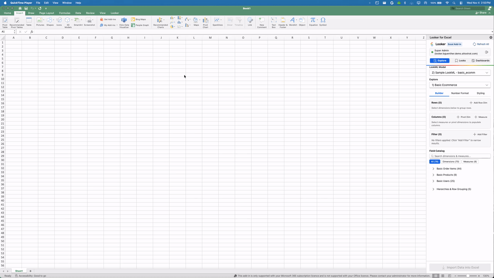
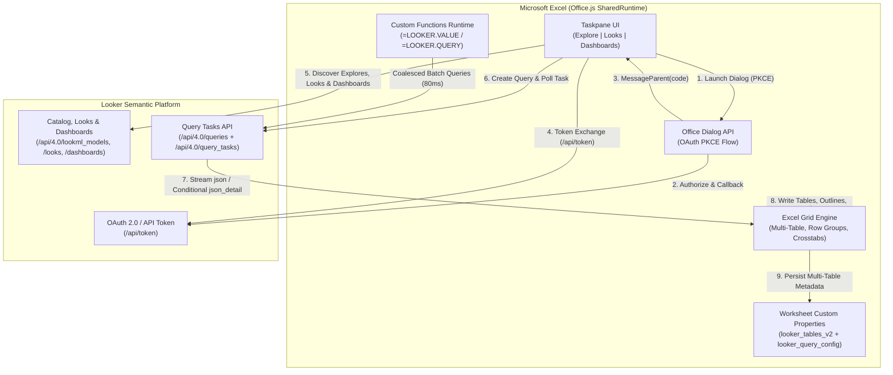

# Looker Microsoft Excel Add-in

Enterprise Microsoft Excel Taskpane and Custom Functions Add-in (Office.js) connecting Excel workbooks directly to Looker's semantic modeling layer. It enables business users, financial analysts, and data teams to authenticate via Looker OAuth 2.0 PKCE, explore models and views, import Saved Looks and Dashboard tiles, evaluate non-additive Looker SQL totals and subtotals, navigate collapsible Row Group hierarchies, build multi-dimension crosstabs, call live `=LOOKER.VALUE()` and `=LOOKER.QUERY()` worksheet formulas, and stream high-volume datasets into Excel worksheets with one-click refresh and formatting preservation.

---

## Walkthrough & Demo



---

## Architecture Overview



---

## Key Capabilities

### Looker CORS OAuth 2.0 with PKCE & Silent Refresh

- Native browser-based OAuth 2.0 authentication utilizing Proof Key for Code Exchange (PKCE, RFC 7636).
- Adheres to Looker's CORS API specification (`scope=cors_api`, 32-byte cryptographic state verification, direct token exchange at `POST /api/token`).
- Operates securely across macOS WebKit, Windows WebView2, and Excel on the Web using the Office Dialog API to avoid third-party cookie restrictions and iframe blocking.
- Implements proactive and silent token validation (`ensureValidToken`) to refresh expired sessions automatically on Excel relaunch and taskpane initialization.

### Top-Level Navigation: Explore, Saved Looks & Dashboards

- **Explore Builder**: Full ad-hoc query builder across LookML models, Explores, dimensions, measures, parameters, and filters.
- **Saved Looks Browser**: Search and browse Looker Saved Looks (`/api/4.0/looks`), import results directly into the active worksheet, or load a Look's underlying query definition into the Explore builder for customization.
- **Dashboards Browser**: Search and inspect Looker Dashboards (`/api/4.0/dashboards`), override dashboard-level filters interactively (mapped automatically to each tile's `listen` declarations), import individual query tiles, or import all tiles on a dashboard into dedicated worksheet tabs in a single batch.
- **Canonical Field Ordering**: Automatically orders imported Look and Dashboard fields so non-pivoted dimensions precede pivoted dimensions and measures (`orderFieldsDimensionsFirst`).

### Looker Semantic Totals, Subtotals & Row Totals

- **Warehouse-Evaluated Non-Additive Aggregations**: Computes column grand totals (`total: true`), pivoted row totals (`row_total: "right"`), and dimension subtotals (`subtotals`) inside Looker SQL so non-additive measures (`count_distinct`, ratios, averages, percentiles) remain exact rather than summing raw Excel cells.
- **Conditional Payload Strategy**: Uses lightweight `result_format: "json"` by default, switches to `json_detail` when subtotals or multi-dimension pivot metadata are required, and automatically splits high-volume grand-total queries (5,000+ rows) into a flat `json` data stream plus a 1-row `json_detail` totals companion query (`split_json_and_total`) to prevent payload bloat.
- **Native Excel Outlines & Accounting Borders**: Interleaves subtotal and grand total rows with bold styling, double-bottom accounting borders, and native Excel collapsible row outline groups (`range.group(Excel.GroupOption.byRows)`).
- **Detailed Query Error Surfacing**: Extracts Looker's structured query task error diagnostics (`errors[].message`, `message_details`, and `looker_error`) from `/api/4.0/query_tasks/{id}/results` when a warehouse query fails.

### Hierarchy Discovery & Indented Row Groups Tree

- **LookML Hierarchy Discovery**: Automatically resolves multi-level hierarchies from LookML field tags (`hierarchy:<group>:<level>` and `drill_next:<field>`), `dimension_group` calendar time ladders (`Year -> Quarter -> Month -> Week -> Date`, excluding sub-day raw/time grains), and `drill_fields` dimension chains.
- **Compact Single-Column Hierarchy Tree**: Mirrors Looker Explore Row Groups and SAP Analysis for Office compact hierarchy display by collapsing grouped dimensions into a single indented `Group` column with expand/collapse indicators (`▾` / `▸`), direct child counts `(N)`, and top-down Looker SQL subtotals on parent nodes.
- **In-Sheet Click-to-Expand & Display Levels**: Clicking any `▸` or `▾` group cell in the worksheet (or changing the Display Level selector between `All Collapsed`, `Level 1`, `Level 2`, `Level 3`, and `All Expanded`) toggles row visibility in-place without re-querying the warehouse.

### Multi-Dimension Pivots & Crosstabs

- **Multi-Dimension Column Pivots**: Supports pivoting one or multiple dimensions simultaneously (`pivotsMeta` cohort combinations) while resolving clean display labels for dimensions backed by LookML `case:` or `order_by_field` sort keys.
- **Measure-First vs. Pivot-Value-First Grouping**: When multiple measures are pivoted, dynamically groups columns either by Measure first (`Measure A [Pivots], Measure B [Pivots]`) or by Pivot Cohort first (`Pivot 1 [Measure A, Measure B]`).
- **Multi-Row Merged Crosstab Headers**: Optionally renders stacked multi-row crosstab headers with merged Excel cells (`range.merge()`) above measure sub-headers, plus one-click **Swap Rows & Columns** axis transposition.

### Multiple Tables per Worksheet & Custom Start Cell Anchor

- **Custom Top-Left Anchor Cell**: Place Looker tables anywhere on a worksheet (e.g., `A1`, `H1`, `B25`) via manual cell input or the **Use Selected Cell** button.
- **Multi-Table Worksheet Catalog**: Stores multiple independent Looker table configurations per worksheet under `looker_tables_v2` in `sheet.customProperties` (maintaining backward compatibility with `looker_query_config`).
- **Active-Cell Hit-Testing & Sibling Collision Protection**: Automatically switches the taskpane context when clicking inside different tables on the same sheet, and restricts residual cell cleanup to avoid overwriting adjacent tables.

### Custom Runtime Worksheet Functions (`=LOOKER.VALUE` & `=LOOKER.QUERY`)

- **SharedRuntime Integration**: Shares authentication tokens and state seamlessly between the React taskpane and Excel's custom function runtime.
- **`=LOOKER.VALUE(model, explore, measure, [filter1_field, filter1_val, ...])`**: Fetches a single governed Looker metric directly into any formula cell. Includes an 80ms request coalescer (`LookerValueBatcher`) that groups concurrent formulas sharing the same model, explore, and filter set into a single Looker query task, backed by a 5-minute TTL cache.
- **`=LOOKER.QUERY(model, explore, fields_csv, [filters_json], [sorts_csv], [limit])`**: Executes a governed Looker query and spills the 2D header and data array directly into the worksheet grid.

### Field Discovery, Typed Filters & High-Volume Streaming

- Search dimensions and measures across names, labels, short labels, view labels, field groups, and LookML synonyms.
- Detects required LookML `parameter` and `always_filter` declarations, displaying an interactive prompt dialog prior to query execution.
- Specialized filter operators for strings (with live Looker suggestion autocompletion), dates (relative timeframes, ranges, exact dates), and numbers.
- Adaptive batch cell budgeting (`batchSize = max(500, floor(35,000 / colCount))`) with suspended screen updating and calculation modes during writes, plus automatic adjacent formula fill-down and user cell formatting preservation on refresh.

---

## Technical Stack

- Framework: React 18, TypeScript, Fluent UI v9 (`@fluentui/react-components`, `@fluentui/react-icons`)
- Host Platform: Office JavaScript API (`Office.js`), Excel JavaScript Requirement Set 1.14+, `SharedRuntime` Custom Functions
- Build & Bundler: Webpack 5, `html-webpack-plugin`, `copy-webpack-plugin`, `ts-loader`
- Development Tooling: `office-addin-dev-certs`, `webpack-dev-server`
- API Target: Looker API 4.0

---

## Prerequisites

1. Node.js: Version 18 or higher with npm.
2. Microsoft Excel:
   - Microsoft 365 on Windows (Microsoft Edge WebView2)
   - Microsoft 365 / Office 2021 on macOS (v16.60+)
   - Excel on the Web (Office Online)
3. Looker Instance: Version 23.0 or higher with network access from your browser and an OAuth Client Application registered.
4. Looker User Permissions & Licensing:
   - End users must be assigned a Looker role containing **`access_data`** and **`explore`** permissions on the target LookML models (Standard User or Developer license tier).
   - The `explore` permission is required by Looker API 4.0 (`/api/4.0/lookml_models` and `/api/4.0/lookml_models/{model}/explores/{explore}`) to discover LookML models and Explore schemas.

---

## Looker Configuration

To allow the Excel add-in to communicate with Looker, register an OAuth Client Application in Looker.

### Register OAuth Client Application

An admin can register the OAuth client via the Looker API or Looker Admin Console:

```bash
curl -X POST "https://<your-instance>.cloud.looker.com/api/4.0/oauth_client_apps" \
  -H "Authorization: token <ADMIN_ACCESS_TOKEN>" \
  -H "Content-Type: application/json" \
  -d '{
    "client_guid": "looker-excel",
    "redirect_uri": "https://localhost:3000/dialog-callback.html",
    "display_name": "Looker Microsoft Excel Add-in",
    "description": "Taskpane integration for Microsoft Excel",
    "enabled": true
  }'
```

For production deployments, set `redirect_uri` to your hosted domain (e.g. `https://<your-production-domain>/dialog-callback.html`).

### CORS Domain Allowlist

Ensure your add-in origin (`https://localhost:3000` for development or your production hosting domain) is added to the domain allowlist in Looker:

1. In Looker, navigate to Admin > Platform > API.
2. In Embedded Domain Allowlist or CORS Allowlist, add your hosting origin.

---

## Installation & Setup

### 1. Clone & Install Dependencies

```bash
git clone https://github.com/<your-org>/looker-on-excel.git
cd looker-on-excel
npm install
```

### 2. Generate Development SSL Certificates

Office add-ins require HTTPS. Generate local certificates trusted by your operating system:

```bash
npx office-addin-dev-certs install
```

### 3. Start Development Server

```bash
npm start
```

The dev server starts on `https://localhost:3000`. You can verify by opening `https://localhost:3000/taskpane.html` in your browser.

---

## Sideloading the Add-in in Excel

### macOS Desktop

1. Verify or create the WEF sideloading folder:
   ```bash
   mkdir -p ~/Library/Containers/com.microsoft.Excel/Data/Documents/wef
   ```
2. Copy the manifest file into the directory:
   ```bash
   cp manifest.xml ~/Library/Containers/com.microsoft.Excel/Data/Documents/wef/
   ```
3. Restart Microsoft Excel.
4. On the Home or Insert ribbon, select the Looker icon, or navigate to Insert > My Add-ins to open the taskpane.

### Windows Desktop

1. Share a folder containing `manifest.xml` over your local network.
2. In Excel, go to File > Options > Trust Center > Trust Center Settings > Trusted Add-in Catalogs.
3. Enter the network share path and click Add Catalog.
4. Check Show in Menu, click OK, and restart Excel.
5. Go to Insert > My Add-ins > Shared Folder, and select Looker for Excel.

### Excel on the Web

1. Open a workbook in [Excel for the Web](https://office.live.com/start/excel.aspx).
2. Go to Insert > Office Add-ins (or Add-ins).
3. Select Manage My Add-ins > Upload My Add-in.
4. Browse to and upload `manifest.xml`.

---

## Usage Guide

1. **Authenticate**:
   - Enter your Looker instance URL (e.g. `https://<your-instance>.cloud.looker.com`) and registered OAuth Client ID (e.g. `looker-excel`).
   - Click Sign in with Looker and complete the authentication flow in the popup dialog.
2. **Choose Mode (`Explore` | `Looks` | `Dashboards`)**:
   - **Explore**: Select a Model and Explore view, pick Dimensions and Measures, toggle `+Pivot` or sort arrows (`↑`/`↓`) on selected field chips, or expand **Hierarchies & Row Grouping** below the views list to enable a collapsible indented hierarchy tree.
   - **Looks**: Search Saved Looks and click **Import** to stream into Excel or **Edit in Explore** to customize fields and filters.
   - **Dashboards**: Select a Dashboard, adjust dashboard-level filters if needed, and import individual tiles or click **Import All Tiles** to generate a multi-sheet report.
3. **Configure Table & Layout Settings**:
   - Set the row limit, destination worksheet, and custom **Start Cell** anchor (e.g. `A1`, `H1`, `B25` or **Use Selected Cell**) to place multiple tables on a single sheet.
   - Enable **Column Grand Totals**, **Row Totals**, or **Dimension Subtotals** to evaluate non-additive aggregations in Looker SQL.
   - When pivoting, configure **Crosstab & Pivot Layout** (Measure-First vs. Pivot-Value-First column ordering and Multi-Row Merged Crosstab Headers).
4. **Use Custom Worksheet Functions**:
   - In any cell, type `=LOOKER.VALUE("model_name", "explore_name", "view.measure", "view.dimension", "filter_value")` to pull live governed KPIs, or `=LOOKER.QUERY("model_name", "explore_name", "view.dim,view.measure", "{\"view.status\":\"Complete\"}", "view.measure desc", 100)` to spill a dynamic array.
5. **Refresh & Interact In-Sheet**:
   - Click any `▸` or `▾` cell in a Row Group hierarchy column to expand or collapse branches directly in the sheet.
   - Use **Refresh Table** to update the selected table or **Refresh All** in the header to refresh all Looker tables and custom functions across the workbook.

---

## Production Deployment & Enterprise Distribution

Deploying the add-in across an enterprise organization follows standard Microsoft 365 Centralized Deployment:

### 1. Host Static Assets

Host the compiled production distribution (`dist/`) on an enterprise HTTPS-enabled static web hosting service or CDN (e.g. Google Cloud Storage + Cloud CDN, Azure Blob Storage + Front Door, or AWS S3 + CloudFront).

### 2. Configure Production Manifest

Update `manifest.xml` to point all endpoint references to your hosted domain:

- Update `<SourceLocation>` URLs to `https://<your-production-domain>/taskpane.html`.
- Update custom functions metadata URL to `https://<your-production-domain>/assets/functions.json`.
- Update dialog and callback URLs to `https://<your-production-domain>/dialog-callback.html`.
- Ensure the `Id` element contains a unique GUID for your organizational deployment.

### 3. Register Production OAuth Client in Looker

In your Looker Admin console (Admin > Platform > API):

- Register an OAuth Client Application with `redirect_uri` matching `https://<your-production-domain>/dialog-callback.html`.
- Add `https://<your-production-domain>` to Looker's CORS / Embedded Domain allowlist.

### 4. Deploy via Microsoft 365 Admin Center

Distribute the add-in to users centrally without individual desktop installation:

1. Navigate to **Microsoft 365 Admin Center** (`admin.microsoft.com`).
2. Go to **Settings** > **Integrated apps** > **Upload custom apps**.
3. Choose **Office Add-in** > **Upload manifest file (.xml)** and select your production `manifest.xml`.
4. Assign users or security groups (e.g. Finance, Analytics, or Entire Organization).
5. Choose deployment method (Fixed or Available).
6. Once published, the Looker add-in and `LOOKER.*` custom functions automatically appear in Excel on Windows, macOS, and Excel on the Web for all assigned users.

---

## Project Structure

```
├── assets/
│   └── functions.json       # Excel Custom Functions metadata (LOOKER.VALUE, LOOKER.QUERY)
├── docs/
│   └── images/              # Walkthrough demo GIF
├── src/
│   ├── auth/                # Office Dialog OAuth authentication handlers
│   │   ├── dialog-auth.html
│   │   ├── dialog-auth.ts
│   │   ├── dialog-callback.html
│   │   └── dialog-callback.ts
│   ├── functions/           # SharedRuntime Excel Custom Functions & 80ms request batcher
│   │   └── functions.ts
│   └── taskpane/            # React taskpane UI and services
│       ├── components/      # UI components (FieldPicker, LooksBrowser, DashboardsBrowser, TableSettings, etc.)
│       ├── services/        # Looker client, queryTaskRunner, excelWriter, hierarchyResolver, sheetMetadata
│       ├── theme/           # Looker design token ramp for Fluent UI v9
│       ├── index.html       # Taskpane HTML shell
│       └── index.tsx        # React & CustomFunctions entrypoint
├── tests/                   # Unit test suites (totals/subtotals, multi-table, custom functions, looks/dashboards, hierarchies, pivots/crosstabs)
├── manifest.xml             # Office Add-in manifest (SharedRuntime + CustomFunctions)
├── tsconfig.json            # TypeScript configuration
├── webpack.config.js        # Webpack build and dev server configuration
└── package.json
```

---

## Verification & Testing

Verify TypeScript compilation:

```bash
npm run typecheck
```

Execute unit test suites:

```bash
npm test
```

Run individual feature test suites directly:

```bash
npx tsx tests/totalsAndSubtotals.test.ts
npx tsx tests/multiTableAndAnchors.test.ts
npx tsx tests/customFunctionsBatcher.test.ts
npx tsx tests/looksAndDashboards.test.ts
npx tsx tests/hierarchyResolver.test.ts
npx tsx tests/pivotsAndSorts.test.ts
```

Compile production distribution:

```bash
npm run build
```

Production build artifacts will be placed in the `dist/` directory.
